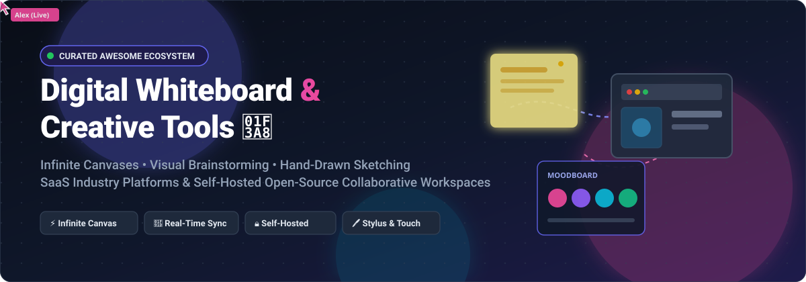

# Awesome Digital Whiteboard & Creative Tools 🎨

  

  
  
  
  
  
  
  

---

## 🌟 Overview & Key Highlights

A comprehensive, curated collection of notable **SaaS/hosted platforms** and **open-source GitHub projects** dedicated to **Digital Whiteboards, Infinite Canvases, and Creative Visual Thinking Tools**. 

Whether you are sketching user experience flows, facilitating distributed enterprise design thinking workshops, moodboarding film concepts, handwriting lecture notes on tablets, or building custom collaborative multiplayer spatial apps with CRDTs—this guide tracks the premier solutions across the ecosystem.

> **Key Focus Areas:** ⚡ *Infinite Canvas Engines* • 🤝 *Real-Time Multiplayer Collaboration* • 🖊️ *Stylus & Ink-to-Shape Workspaces* • 📌 *Creative Moodboarding* • 🔒 *Self-Hosted & Local-First Diagramming*

---

## 📑 Table of Contents

- [📊 Sector Overview & Market Dynamics](#-sector-overview--market-dynamics)
- [☁️ SaaS/Hosted Platforms](#️-saashosted-platforms)
- [💻 Open-Source GitHub Projects](#-open-source-github-projects)
  - [🏆 Core Whiteboards & Infinite Canvases](#-core-whiteboards--infinite-canvases)
  - [🛠️ Foundational Canvas Engines & CRDT Frameworks](#️-foundational-canvas-engines--crdt-frameworks)
- [🤝 How to Contribute](#-how-to-contribute)
- [💖 Support & Share](#-support--share)
- [📈 Star History](#-star-history)
- [⚖️ Disclaimer](#️-disclaimer)

---

## 📊 Sector Overview & Market Dynamics

The global interactive and digital whiteboard market is estimated at **$4.6B to $5.3B** (projected to reach over **$7B–$11B by 2030–2035** at a ~6.1%–7.6% CAGR). The visual collaboration sector is **moderately concentrated at the high-end enterprise layer**—dominated by mega-cap ecosystem platforms (Microsoft, Figma) and major incumbents (Miro, Lucid)—while remaining **fragmented across specialized niches** (creative moodboards, agile workshop facilitators, and privacy/compliance platforms) undergoing active acquisition consolidation.

---

## ☁️ SaaS/Hosted Platforms

| Platform | Company Size (Valuation / Revenue) | Pricing (Starting Tier) | Free Tier Limits | Description |
| :--- | :--- | :--- | :--- | :--- |
| **[Microsoft Whiteboard](https://microsoft.com)** | **~$3.1T Market Cap** / ~$245B ARR (Microsoft) | Included with Microsoft 365 Personal at **$6.99/mo** (or $69.99/yr); Microsoft 365 Business Basic at **$6.00/user/mo** | **Free forever**: Free web canvas access with a personal Microsoft Account (5 GB cloud storage limit; standalone native apps retired in favor of web/Teams) | Cloud-synced collaborative canvas deeply integrated into Microsoft Teams, Surface Hub, and Microsoft 365 with Copilot sticky-note organization and ink-to-shape tools. |
| **[FigJam (Figma)](https://figma.com)** | **~$68B Market Cap** / ~$1.06B ARR (Figma, NYSE: FIG) | **$3.00/user/mo** (Collab seat for FigJam); Full Figma Editor seat from **$20.00/user/mo** (billed annually) | **Free forever**: Free Starter plan allows up to **3 active collaborative files**, up to 3 pages per file, and 30-day version history | Multiplayer online whiteboard built by Figma for product teams to brainstorm, map user flows, run design sprints, and seamlessly copy assets into Figma Design files. |
| **[Lucidspark (Lucid Software)](https://lucid.co)** | **~$3.0B–$4.5B Valuation** / ~$150M–$260M ARR | Individual plan starts at **$7.95/mo** (billed annually) or **$9.95/mo** (billed monthly) | **Free forever**: Limited to **3 editable boards**, 3 basic templates, and standard visual collaboration tools | Cloud virtual whiteboard enabling real-time brainstorming, mind mapping, breakout boards, and direct conversion of sticky notes into Lucidchart technical diagrams. |
| **[Mural](https://mural.co)** | **~$2.0B Valuation** / ~$125M–$189M ARR | Team+ plan starts at **$9.99/user/mo** (billed annually) or **$12.00/user/mo** (billed monthly) | **Free forever**: Unlimited total murals created, but **only 3 most recent murals remain editable** (older boards lock to view-only); unlimited members | Visual collaboration and guided facilitation whiteboard platform tailored for design thinking, remote workshops, sticky-note synthesis, and enterprise consulting. |
| **[Miro](https://miro.com)** | **~$1.79B Valuation** ($1.355B EV acquisition) / ~$600M+ ARR | Starter plan starts at **$8.00/user/mo** (billed annually) or **$10.00/user/mo** (billed monthly) | **Free forever**: Up to **3 editable boards** (older boards lock to view-only), core templates, unlimited team members, and 10 AI credits/mo | Leading enterprise online collaborative whiteboard and visual innovation workspace featuring infinite canvases, AI clustering, timer/voting workshops, and 100+ app integrations. |
| **[Bluescape](https://bluescape.com)** | **~$18M–$21M ARR** (Acquired by Charles Thayne Capital) | Team/Pro tier starts at **$10.00/user/mo**; Enterprise custom quotes (formerly ~$20/user/mo Business) | **30-day free trial** with standard workspace features upon sales setup (no self-serve permanent free plan) | High-security virtual visual workspace designed for large-scale media review, multi-wall command centers, and creative production teams. |
| **[Klaxoon](https://klaxoon.com)** | **~$20M ARR** (€20M+ milestone, acquired by Wrike; $73M total raised) | Starter plan starts at **$24.90/user/mo** (or €24.90/user/mo) | **Free forever**: **1 active open activity** at a time, up to **5 participants/guests**, and maximum **50 ideas** per board | Interactive visual collaboration suite uniting infinite whiteboards (Board), live audience quizzes/polls, and async workshop workflows. |
| **[Conceptboard](https://conceptboard.com)** | **~€10M–€50M EV Range** (€10M growth round; ~$10.5M raised) | Starter plan starts at **€5.00/user/mo** (approx. $5.40/user/mo) | **Free forever**: Up to **3 active boards**, maximum **100 objects per board**, and 250 MB–500 MB total file storage | GDPR-compliant, enterprise-grade online collaborative whiteboard engineered for visual project management, creative asset review, and remote team workshops. |
| **[Stormboard](https://stormboard.com)** | **~$10M ARR** (~18 employees) | Business plan starts at **$8.33/user/mo** (billed annually) or **$10.00/user/mo** (billed monthly) | **Free forever**: Up to **5 digital workspaces (Storms)** with a maximum of **5 collaborators** per workspace | Data-driven digital brainstorming and planning workspace combining sticky-note whiteboards with structured smart-templates and instant report exports. |
| **[Milanote](https://milanote.com)** | **~$2.8M ARR** (20–25 employees, bootstrapped/independent) | Personal plan starts at **$9.99/mo** (billed annually) or **$12.50/mo** (billed monthly) | **Free forever**: Capped at **100 notes, images, or links** across all boards, and **10 file uploads** total | Visual moodboard and creative organization workspace prized by designers, filmmakers, writers, and creative directors for arranging images, color palettes, notes, and links. |

---

## 💻 Open-Source GitHub Projects

Curated open-source applications and infinite-canvas tools, **sorted by star count (descending)**. Each project includes a real-time star badge linking to its GitHub stargazers page.

### 🏆 Core Whiteboards & Infinite Canvases

- **[Excalidraw (`excalidraw/excalidraw`)](https://github.com/excalidraw/excalidraw)**   
  Flagship open-source virtual whiteboard with a signature hand-drawn look, end-to-end encrypted real-time multiplayer collaboration, reusable community libraries, and local-first storage.

- **[AFFiNE (`toeverything/AFFiNE`)](https://github.com/toeverything/AFFiNE)**   
  Next-generation all-in-one open-source knowledge base fusing docs, whiteboards, and database tables into an infinite edgeless canvas (Miro + Milanote + Notion alternative) with CRDT sync.

- **[draw.io Desktop (`jgraph/drawio-desktop`)](https://github.com/jgraph/drawio-desktop)**   
  Official Electron cross-platform desktop suite of diagrams.net / draw.io for completely offline, private diagramming, flowcharting, and visual architecture design.

- **[tldraw (`tldraw/tldraw`)](https://github.com/tldraw/tldraw)**   
  Premier open-source infinite canvas engine and React SDK for constructing responsive multiplayer whiteboards, spatial interfaces, AI visual prompts, and custom creative tools.

- **[Logseq (`logseq/logseq`)](https://github.com/logseq/logseq)**   
  Privacy-first, local-first open-source knowledge management platform with an integrated spatial whiteboard for mind-mapping, bi-directional linking, and PDF annotation.

- **[Xournal++ (`xournalpp/xournalpp`)](https://github.com/xournalpp/xournalpp)**   
  Feature-packed cross-platform handwriting note-taking and digital whiteboard software with pressure-sensitive stylus support, PDF markup, and LaTeX math rendering.

- **[Drawnix (`plait-board/drawnix`)](https://github.com/plait-board/drawnix)**   
  All-in-one open-source whiteboard and SaaS diagramming suite uniting mind mapping, flowcharting, freehand drawing, and collaborative canvas layouts.

- **[Rnote (`flxzt/rnote`)](https://github.com/flxzt/rnote)**   
  Modern vector-based drawing and handwritten note-taking app written in Rust and GTK4, featuring an infinite sheet canvas, stylus tilt/pressure support, and SVG/PDF export.

- **[diagrams.net Web (`jgraph/drawio`)](https://github.com/jgraph/drawio)**   
  Web-based core of draw.io powering online browser diagramming, architecture mapping, and embedded whiteboards with GitHub, GitLab, and Nextcloud storage.

- **[Lorien (`mbrlabs/Lorien`)](https://github.com/mbrlabs/Lorien)**   
  Ultra-fast, minimalist infinite-canvas vector sketchpad and brainstorming tool built with the Godot Engine for silky smooth, near-zero latency pen input.

- **[Flat (`netless-io/flat`)](https://github.com/netless-io/flat)**   
  Full-featured open-source online classroom and interactive whiteboard desktop/web application with audio/video room integration powered by Agora.

- **[OpenBoard (`OpenBoard-org/OpenBoard`)](https://github.com/OpenBoard-org/OpenBoard)**   
  Widely used open-source interactive teaching whiteboard application tailored for schools, universities, interactive smart-boards, and lecture recording.

- **[WBO — Whitebophir (`lovasoa/whitebophir`)](https://github.com/lovasoa/whitebophir)**   
  Lightweight, self-hosted Node.js collaborative online whiteboard allowing dozens of users to sketch, write, and brainstorm simultaneously in real time without signup.

- **[PixelBoard (`Akshayykadam/PixelBoard`)](https://github.com/Akshayykadam/PixelBoard)**   
  Interactive open-source digital whiteboard and creative canvas built for fluid sketching, AI-assisted voice dictation, and visual brainstorming.

- **[BeeRef (`rbreu/beeref`)](https://github.com/rbreu/beeref)**   
  Lightweight, clean visual reference image board application (Milanote / PureRef open-source alternative) for organizing creative assets, concept art, and moodboards.

- **[Nextcloud Whiteboard (`nextcloud/whiteboard`)](https://github.com/nextcloud/whiteboard)**   
  Collaborative infinite whiteboard app integrated directly into Nextcloud Talk and Files for privacy-first, on-premise team visual collaboration.

---

### 🛠️ Foundational Canvas Engines & CRDT Frameworks

Essential open-source building blocks for engineering custom collaborative whiteboards, spatial editors, and creative canvas experiences:

- **[xyflow / React Flow & Svelte Flow (`xyflow/xyflow`)](https://github.com/xyflow/xyflow)**   
  Highly customizable interactive node-based canvas library for React and Svelte, widely used to construct visual diagramming engines, workflow builders, and mind maps.

- **[Fabric.js (`fabricjs/fabric.js`)](https://github.com/fabricjs/fabric.js)**   
  Powerful HTML5 canvas library and SVG-to-canvas parser providing an interactive object model for building drawing tools, stickers, and vector whiteboards.

- **[Yjs (`yjs/yjs`)](https://github.com/yjs/yjs)**   
  High-performance Conflict-free Replicated Data Type (CRDT) framework powering multiplayer real-time collaboration, shared cursor awareness, and state sync in infinite canvases.

- **[Rough.js (`rough-stuff/rough`)](https://github.com/rough-stuff/rough)**   
  Graphics library that lets you draw in a charming, sketchy, hand-drawn style—the underlying rendering primitive behind Excalidraw and hand-sketched diagrammers.

- **[Konva.js (`konvajs/konva`)](https://github.com/konvajs/konva)**   
  2D HTML5 canvas JavaScript framework for high-performance interactive graphics, visual diagram editors, multi-layer whiteboards, and touch/drag transformations.

---

## 🤝 How to Contribute

Contributions are warmly welcomed! Help make this curated directory the best guide for digital visual collaboration:

1. 🍴 **Fork the repo** to your GitHub account.
2. 🌿 **Create a new branch** (`git checkout -b add-awesome-tool`).
3. 📝 **Add/edit entries** in `README.md` following the table/list formats. Ensure links are direct, descriptions factual, and state whether it is SaaS or open-source.
4. ⭐ **Provide GitHub repo stars** if adding an open-source project.
5. 🚀 **Submit a Pull Request** with a concise description of why the tool belongs in this list.

---

## 💖 Support & Share

If you find this curated directory helpful for your work, team, or creative workflow, please consider showing your support:

- ⭐ **Star this repository** to help other designers, engineers, and creators discover it.
- 🍴 **Fork & Share** with your team and community on [X / Twitter](https://twitter.com), [LinkedIn](https://linkedin.com), and [Reddit](https://reddit.com).
- ☕ **Buy me a coffee / Sponsor**: Support ongoing maintenance, research, and curation on the [GitHub Sponsors Dashboard](https://github.com/sponsors/ishandutta2007). Your sponsorship helps keep these ecosystem guides fresh, accurate, and community-driven!

  

---

## 📈 Star History

---

## ⚖️ Disclaimer

- This is a community-curated list compiled for educational, architectural, and discovery purposes; inclusion does not constitute commercial endorsement.
- Licensing varies across open-source tools: verify individual licenses (e.g., MIT, AGPL-3.0, GPL-3.0, or source-available clauses like tldraw) before embedding in proprietary products.
- When self-hosting multiplayer whiteboards for confidential roadmaps or internal system architectures, ensure adequate WSS/HTTPS transport encryption and access control enforcement.

---

  <b>Built with ❤️ for product designers, educators, visual thinkers, remote teams, and open-source contributors worldwide.</b> 
  <i>Let's make digital whiteboards and creative canvases open, spatial, and user-owned.</i>

